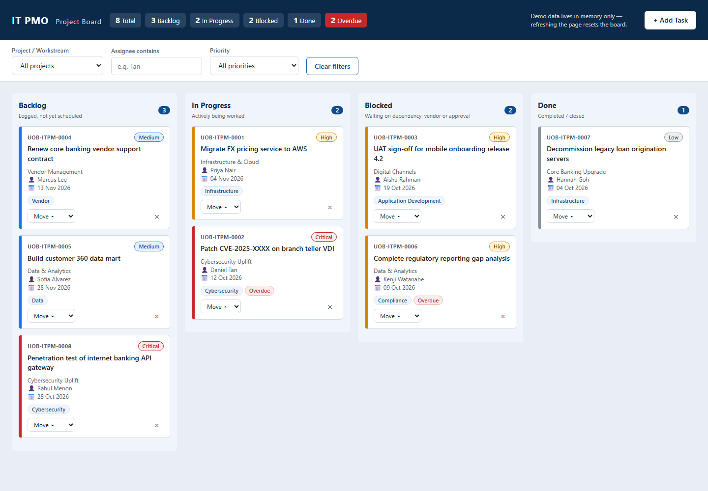

# Kanban6

IT PMO Kanban board demo (single-file vanilla HTML/CSS/JS). It's a training and demo tool for the internal IT Project Management Office of a **fictitious** bank. It is not affiliated with, endorsed by, or an official system of any real bank.

**Live demo:** https://merrickkw.github.io/Kanban6/

## Features

- **Four columns:** Backlog, In Progress, Blocked, Done. Each column shows a count of the tasks currently visible in it.
- **Add tasks** through a dialog with validation: title, description, project/workstream, category, assignee, priority, due date and status. Task IDs follow the format `UOB-ITPM-####`.
- **Move tasks** by drag and drop, or with the "Move ▸" menu on each card (works with the keyboard).
- **Delete tasks**, with a confirmation step.
- **Filters** by project/workstream, assignee (text match) and priority.
- **Summary strip** with totals across all tasks, including how many are overdue.
- **Overdue highlighting** on cards whose due date has passed. Seed due dates are relative to today, so some are always overdue.
- **Email notification** via [FormSubmit](https://formsubmit.co/) when a task is added. If sending fails, you only see a warning; the board keeps working.

## Run locally

Open `index.html` in a browser. There's no build step, server or install.

To turn on email notifications, change the address in `FORMSUBMIT_ENDPOINT` near the top of the `<script>` in `index.html`. FormSubmit sends a one-time activation email to that address the first time it's used. Note: any address you put there is publicly visible in the repo and on the live site.

## No persistence

Board data lives in memory only. Refreshing the page resets it to the seeded demo data. The app doesn't use localStorage, sessionStorage, IndexedDB or cookies.

## Tech constraints

- Vanilla HTML, CSS and JavaScript in one file (`index.html`).
- No frameworks, bundlers, npm packages, CDN scripts, web fonts or image files. It uses the system font stack and inline SVG/Unicode for icons.
- The only network call is the FormSubmit AJAX endpoint.

## Deployment

The site is deployed to GitHub Pages by the GitHub Actions workflow in [`.github/workflows/pages.yml`](.github/workflows/pages.yml). It runs on every push to `main`, or manually from the Actions tab. Only `index.html` is published.

## Disclaimer

All names, projects, tasks and data are fictitious. This is for demo and training use only.
